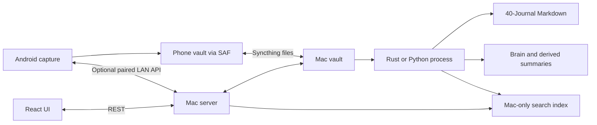
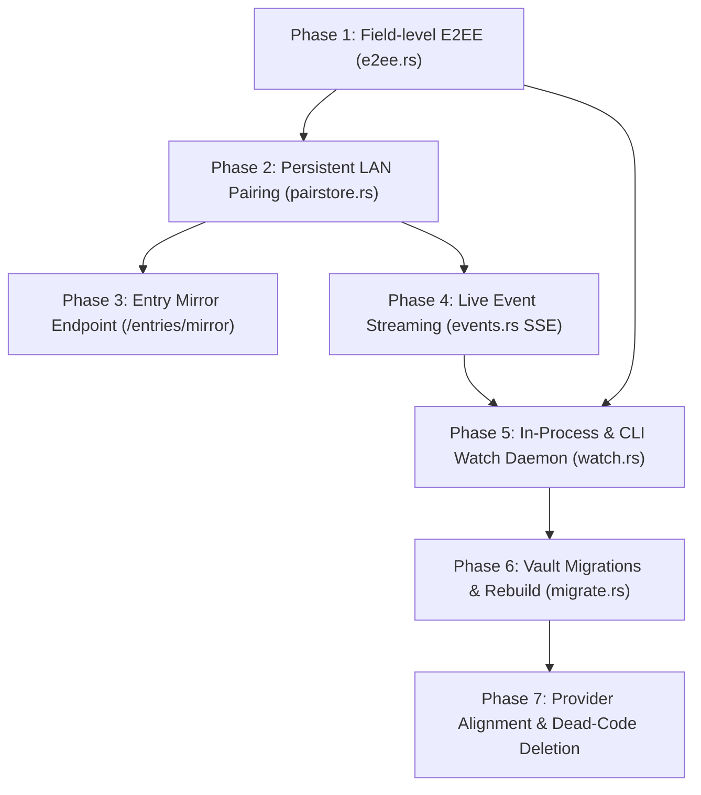
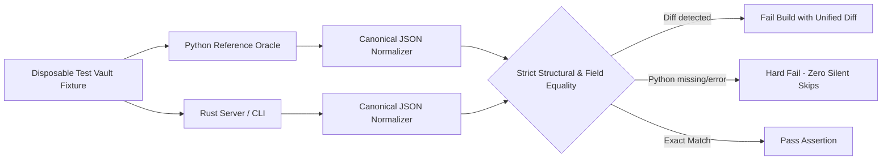

# Chronicle architecture

Chronicle shares a file contract across Android, a Rust desktop/server runtime, and a Python toolchain. The data vault is independent of the source repository. This guide describes source ownership; it is not a claim that every runtime path has been qualified on a physical device.

## Runtime owners

| Component | Entry point | Responsibility |
| --- | --- | --- |
| Android | [MainActivity.kt](../chronicle-android/app/src/main/java/com/chronicle/app/MainActivity.kt) | Compose UI, SAF capture and browsing, optional Mac API access |
| Tauri shell | [lib.rs](../chronicle-pc/desktop/src-tauri/src/lib.rs), [embedded.rs](../chronicle-pc/desktop/src-tauri/src/embedded.rs) | Native windows, tray, capture surface, in-process Rust server lifecycle |
| Rust CLI | [main.rs](../chronicle-pc/server/src/main.rs) | Native serve/process/index/brain and selected maintenance commands |
| Rust transport | [serve.rs](../chronicle-pc/server/src/serve.rs), [api.rs](../chronicle-pc/server/src/api.rs) | API, pairing, loopback HTTP, LAN TLS, frontend asset serving |
| Shared UI | [App.tsx](../chronicle-pc/frontend/src/App.tsx) | Timeline, Notes, Brain, Settings over REST |
| Python CLI | [cli.py](../chronicle-pc/pipeline/chronicle_pipeline/cli.py) | Alternative FastAPI server, watcher, migrations, maintenance |

The shell calls `embedded::boot`; that path prepares and runs `chronicle_server::serve` on the Tauri async runtime. There is no Python sidecar in this path. The shell still discovers the PC checkout and the server serves the shared UI from disk. The shell's own `desktop/dist/` is not the same build as `frontend/dist/`.

## Capture, filing, and retrieval

1. Capture clients write structured entry JSON under `_capture/entries/yyyy/MM/` and media under `_attachments/`.
2. Processing fills available transcripts/captions, files prose into entry-specific Markdown fences, updates state, and refreshes derived knowledge.
3. Structured fields remain in entry JSON. Once filed, journal prose lives in `40-Journal/YYYY-MM-DD.md`.
4. Journal amendments use content hashes to detect changed blocks. Conflicts need an explicit resolution; local atomic writes and locks do not create a distributed transaction across Syncthing peers.
5. Brain curation intent is appended to `curation/ops/<device>.jsonl`. The generated graph lives at `brain/graph.json`; it is not itself an append-only log.
6. Search uses a Mac-only index, local Ollama embeddings, and keyword retrieval. Source references should remain visible when presenting recall results.

## Vault ownership

| Path | Meaning | Sync / editing |
| --- | --- | --- |
| `_capture/entries/` | Entry metadata and processing state | Synced; client edits restricted after processing |
| `_attachments/` | Capture media | Synced |
| `40-Journal/` | Filed prose | Synced; preserve fences and use conflict-aware amends |
| `00-Inbox/` | Unsorted knowledge notes | Synced, editable |
| `10-Work/` | Work, projects, people, ResumePoints | Synced, editable |
| `20-Personal/` | Personal notes and responsibilities | Synced, editable |
| `30-Knowledge/` | Evergreen knowledge and reference | Synced, editable |
| `90-Archive/` | Archived knowledge | Synced, editable |
| `brain/` | Graph, enrichment, tags, insights | Mac-generated, synced for reading |
| `_system/derived/` | Regenerable aggregates | Mac-generated, synced |
| `curation/ops/` | Per-device graph-edit intent | Synced, append-only |
| `index/` | Search database and server discovery | Mac-only, excluded from sync |
| `config.json` | Vault version, timezone, model/provider configuration | PC-owned; never put credentials here |

`40-Journal/` is a journal, not a generic PARA knowledge area. `kb/files/` and `kb/knowledge.json` retain specific reference/profile roles; `kb/notes/` is retired. The archived `KnowledgeBase/` product and the generic vault setup prompt are not alternate live implementations.

## Data and network boundaries

- **Folder sync:** Syncthing moves files. A paired API session, entry mirror, or SSE update is not a complete folder-sync receipt.
- **LAN:** Rust serves loopback HTTP for the local UI and pinned TLS on the LAN address. Pairing tokens persist per device and can be revoked. Loopback trust does not make a local process harmless.
- **Cloud:** Ollama is the default provider. Grok is wired in both Mac runtimes. Vertex is Python-only: a Rust adapter file exists, but the active provider factory rejects it. Android has Grok. Text cloud consent and vision cloud consent are distinct. Model/provider availability is a runtime dependency.
- **Secrets:** Mac credentials live outside the vault, including `~/.config/chronicle/secrets.json`; this is a local file, not an OS keychain. Android stores cloud settings through protected preferences. Synced configuration can influence provider choices, so trust of sync peers still matters.
- **Encryption:** `text_enc` is optional entry-text encryption. Do not advertise whole-vault encryption: Markdown journals, attachments, and all derived files are not covered merely by enabling it. Locking and index purge behavior is specified in the shared contract and tested separately.
- **Offline:** Capture and already-synced browsing do not require a Mac connection. Full-vault phone recall needs a reachable Mac; local AI requires downloaded models and the appropriate runtime.

No security behavior is changed by this documentation update. [SECURITY.md](../SECURITY.md) defines the review boundaries; [CONTRACT.md](../chronicle-pc/CONTRACT.md) defines the detailed wire formats.

## Single-owner runtime architecture and transition plan

Chronicle is transitioning to a **single production owner (Rust)** across the Mac desktop application, background server, and CLI toolchain. Under house policy, Python is permitted only as a reference test oracle, a fixture generator, or throwaway migration scripts; shipped production daemons and services must not depend on a Python runtime.

### Duplicated module inventory and ownership

Today, approximately 32 modules are implemented in both Rust (`chronicle-pc/server/src/`) and Python (`chronicle-pc/pipeline/chronicle_pipeline/`). Because no assertion-backed parity test has proven their equivalence, behavioral drift has emerged across runtimes. 

Rust is designated as the sole production owner for all runtime modules. Python modules are categorized for their future role:
- **`oracle`**: Retained as a reference test oracle to verify Rust behavior via automated parity test harnesses and golden fixtures.
- **`delete`**: Scheduled for deletion once the Rust implementation is verified, as they provide no oracle value (thin wrappers, static prompts, or OS-level primitives).

| Module | Rust path | Python path | Lines (RS / PY) | Responsibility | Chosen owner | Python future role | Rationale and drift risks |
| --- | --- | --- | --- | --- | --- | --- | --- |
| **pipeline / process** | `server/src/pipeline.rs` | `pipeline/process.py`, `api/process.py` | 314 / 310 | Vault processing pipeline, attachment handling, journal filing, state machine | **Rust** | **oracle** | Rust lacks E2EE decryption, so `process` refuses a vault whose config enables E2EE and never processes or files an entry carrying `text_enc` (`chr-rust-process-e2ee-empty-fence`; `pipeline::e2ee_fail_closed_tests`). Python serves as oracle for journal fence layout and metadata state. |
| **journal** | `server/src/journal.rs` | `pipeline/journal.py`, `api/journal.py` | 543 / 632 | Daily journal markdown (`40-Journal/YYYY-MM-DD.md`), fences, conflict detection, block amends | **Rust** | **oracle** | Preserves fence parsing, content hash calculation, and conflict-detection equivalence across daily files. |
| **captions** | `server/src/captions.rs` | `pipeline/captions.py` | 52 / 44 | Image attachment captioning via vision LLM | **Rust** | **delete** | Thin wrapper over LLM provider. Rust dropped Ollama fallback during cloud outages (`chr-image-caption-reliability`). Delete Python once Rust provider fallback is hardened. |
| **transcribe** | `server/src/transcribe.rs` | `pipeline/transcribe.py` | 199 / 129 | Audio transcription via `whisper-cli` subprocess | **Rust** | **delete** | Subprocess invocation. Rust historically lacked execution timeouts, causing hung processes to hold vault locks. Delete Python once Rust timeout is verified. |
| **index_store** | `server/src/index_store.rs` | `pipeline/index_store.py` | 831 / 778 | SQLite search index (`index/chronicle.db`), FTS5 full-text, sqlite-vec vector search | **Rust** | **oracle** | Hot path. Rust provides significant performance and concurrency advantages. Python serves as oracle for FTS tokenization, chunk boundary splitting, and BM25 ranking. |
| **rag** | `server/src/rag.rs` | `pipeline/rag.py` | 977 / 738 | Hybrid search (`/search`), RAG question answering (`/ask`), reciprocal rank fusion | **Rust** | **oracle** | Algorithmic ranking and context assembly oracle. Python validates retrieval recall, score normalization, and prompt formatting. |
| **markdown_index** | `server/src/markdown_index.rs` | `pipeline/markdown_index.py` | 151 / 191 | Backlink aggregation, tag indexing, stats in `_system/index.md` | **Rust** | **oracle** | Markdown generation oracle. Exact diff testing against golden vault outputs. |
| **notes** | `server/src/notes.rs` | `pipeline/notes.py`, `api/notes.py` | 324 / 392 | PARA notes CRUD, title extraction, frontmatter management | **Rust** | **oracle** | Verifies note resolution, YAML frontmatter formatting, and directory traversal limits. |
| **frontmatter** | `server/src/frontmatter.rs` | `pipeline/note_frontmatter.py` | 165 / 84 | YAML frontmatter parsing, key sorting, newline preservation | **Rust** | **oracle** | Format normalization oracle for stable frontmatter round-trips. |
| **brain** | `server/src/brain.rs` | `pipeline/brain/` (5 files) | 1209 / 901 | Knowledge graph (`graph.json`), insights (`insights.json`), tags (`tags.json`) | **Rust** | **oracle** | Complex graph topology and insight synthesis. Python acts as reference oracle for JSON schema and graph invariant checks. |
| **prompts** | `server/src/prompts.rs` | `pipeline/brain/prompts.py` | 29 / 66 | LLM prompt templates for brain extraction and insights | **Rust** | **delete** | Static prompt text constants. Single owner in Rust. |
| **curation** | `server/src/curation.rs` | `pipeline/curation.py` | 617 / 347 | Log-based curation ops (`curation/ops/<device>.jsonl`), replay, op compaction | **Rust** | **oracle** | Verifies algebraic invariants of compaction (`pin`/`unpin`, `create`/`delete`) and deterministic graph state reconstruction. |
| **doctor** | `server/src/doctor.rs` | `pipeline/doctor.py` | 460 / 636 | Vault integrity diagnostics, sync conflict repair, mirror hazard detection | **Rust** | **oracle** | Diagnostic report oracle. Python verifies detection coverage across corrupted vault test fixtures. |
| **backup** | `server/src/backup.rs` | `pipeline/backup.py` | 485 / 92 | Vault zip archive generation; exclusions (`index/`, `.git/`, `.venv/`, `__pycache__/`, `.stfolder/`, `*.tmp`, `.DS_Store`) read by both runtimes from `contract/backup-exclusions.json` | **Rust** | **oracle** | Fails loud on unreadable files/directories and on the walk-depth cap, and writes via temp file + rename so a failed run leaves no zip (`chr-backup-silent-skips-restore-test`). Restore drill: `backup_restore_round_trip_passes_doctor`. Oracle verifies archive manifests. |
| **export** | `server/src/export.rs` | `pipeline/export.py` | 47 / 56 | Vault export bundles (`chronosflow`) | **Rust** | **delete** | Simple serialization bundle without complex logic. |
| **lock** | `server/src/lock.rs` | `pipeline/lock.py` | 153 / 62 | Cross-process file locking (`.chronicle.lock`) via `flock` | **Rust** | **delete** | Low-level OS lock primitive. Rust implementation is canonical. |
| **path_map** | `server/src/path_map.rs` | `pipeline/path_map.py` | 428 / 399 | Path traversal security, symlink containment, canonicalization | **Rust** | **oracle** | Security boundary oracle: ensures symlink breakout vectors and traversal attacks are rejected identically. |
| **paths / layout** | `server/src/paths.rs` | `pipeline/paths.py`, `vault_paths.py`, `vault_layout.py` | 151 / 309 | Vault directory resolution and layout version validation | **Rust** | **delete** | Path utility functions; no oracle utility. |
| **config** | `server/src/config.rs` | `pipeline/config.py` | 418 / 148 | `config.json` loading, default derivation, serialization dropping nulls | **Rust** | **oracle** | Schema validation oracle: verifies field parsing, defaults, and serialization fidelity. |
| **models** | `server/src/models.rs` | `pipeline/models.py` | 183 / 217 | Data structures for entries, notes, search hits, and API payloads | **Rust** | **oracle** | Pydantic models serve as the contract schema oracle against Serde structures. |
| **entries** | `server/src/entries.rs` | `pipeline/entries.py`, `api/entries.py` | 253 / 713 | Entry loading, date-range filtering, capture schema validation | **Rust** | **oracle** | Oracle for entry reading, date normalization, and validation rules. |
| **kb / kb_enrich** | `server/src/kb.rs`, `kb_enrich.rs` | `pipeline/api/kb.py`, `kb_enrich.py` | 543 / 628 | Knowledge base hierarchy, note templates, entity extraction | **Rust** | **oracle** | Oracle for tree generation, frontmatter templates, and entity metadata schemas. |
| **link_repair** | `server/src/link_repair.rs` | `pipeline/link_repair.py` | 179 / 278 | Wikilink target analysis and rewrite across vault markdown files | **Rust** | **oracle** | Wikilink extraction and replacement equivalence oracle. |
| **rollup** | `server/src/rollup.rs` | `pipeline/rollup.py` | 58 / 75 | Weekly, monthly, and yearly derived rollup summaries | **Rust** | **oracle** | Text summary structure and date boundary grouping oracle. |
| **topics** | `server/src/topics.rs` | `pipeline/topics.py` | 109 / 138 | Topic cluster pages and dream symbol extraction | **Rust** | **oracle** | Topic categorization and dream symbol pattern matching oracle. |
| **upcoming** | `server/src/upcoming.rs` | `pipeline/upcoming.py` | 115 / 119 | Deadline extraction, scheduled task aggregation | **Rust** | **oracle** | Date regex pattern extraction and deadline sorting oracle. |
| **serve / api** | `server/src/serve.rs`, `api.rs` | `pipeline/serve.py`, `api/` (13 files) | 2651 / 1499 | HTTP REST API, Axum routing, CORS, SPA static asset serving | **Rust** | **oracle** | Contract test oracle for all endpoints specified in `CONTRACT.md`. |
| **tls** | `server/src/tls.rs` | `pipeline/tls_certs.py` | 453 / 176 | Self-signed LAN TLS certificate generation, SANs, SHA-256 fingerprint pins | **Rust** | **oracle** | Cryptographic certificate SAN extension and SHA-256 pin formatting oracle. |
| **ollama / grok** | `server/src/ollama.rs`, `grok.rs`, `provider.rs` | `pipeline/ollama.py`, `llm/` (6 files) | 861 / 431 | LLM provider abstraction, streaming, consent validation, rate limiting | **Rust** | **delete** | External API client implementations; no oracle value once Rust clients pass protocol integration tests. |
| **vertex** | `server/src/vertex.rs` | `pipeline/llm/vertex_provider.py` | 567 / 313 | Vertex AI service-account JWT signing (RS256) and Gemini client | **Rust** | **delete** | Rust contains a complete 567-line implementation with `ring` JWT signing that is currently rejected in `provider.rs`. Enable or retire in Rust; delete Python once decided. |

---

### Ordered port plan for Python-only shipped behaviour

The following critical production behaviors currently exist solely in Python and must be ported to Rust in strict dependency order:

#### Phase 1: Field-level E2EE cryptography and vault state
- **Motivation**: Rust has no key derivation, so it cannot process E2EE vaults at all: `process` refuses them and skips sealed entries rather than filing empty journal fences (`chr-rust-process-e2ee-empty-fence`). 
- **Scope**:
  - Implement `server/src/e2ee.rs` using `ring::pbkdf2` (600,000 iterations, HMAC-SHA256) and `ring::aead::AES_256_GCM` (already linked in `Cargo.toml`).
  - Wire process-lifetime in-memory key state (`Arc<RwLock<Option<ZeroizingKey>>>`).
  - Implement API endpoints: `/auth/e2ee/status`, `/auth/e2ee/unlock`, `/auth/e2ee/lock`, `/auth/e2ee/rotate`.
  - Implement CLI commands: `e2ee-setup`, `unlock`, `lock`.
  - Integrate into `server/src/pipeline.rs`: decrypt entries before filing journal fences; refuse plaintext writes in encrypted vaults.
  - Integrate into `server/src/index_store.rs`: purge or skip encrypted entries on lock.
- **Hot-path benchmarks**:
  - *PBKDF2 key derivation latency*: Measure derivation time across 600,000 iterations. Must execute off-reactor via `tokio::task::spawn_blocking` to avoid stalling async request handling.
  - *Batch decryption throughput*: Benchmark decrypting 1,000 encrypted entries during pipeline execution (min-of-N, target < 15ms total overhead).

#### Phase 2: Persistent LAN pairing and device authorization store
- **Motivation**: Rust currently uses a single ephemeral in-memory pairing token that is lost on restart, lacks per-device tracking, and does not support device revocation (`ft-1674816c7708b047d56744ad8570c2d0`).
- **Scope**:
  - Implement `server/src/pairstore.rs` persisting to `~/.config/chronicle/pairing.json` (mode 0600) with advisory file locking (`libc::flock`) and mtime hot-reloading.
  - Support multiple named devices with token rotation and revocation.
  - Implement API endpoints: `/auth/devices`, `/auth/devices/{name}` (delete/revoke), and progressive delay / rate limiting on `/auth/pair` (3 failed attempts -> 429).
  - Implement CLI commands: `pair`, `unpair`, `pairs`.
  - Wire into `server/src/serve.rs` request validation middleware.
- **Benchmark**:
  - Auth token lookup latency under 500 concurrent requests (measure read-lock contention on hot-reloading store).

#### Phase 3: LAN entry mirror endpoint (`/entries/mirror`)
- **Motivation**: Phone captures synced over LAN outbox require `POST /entries/mirror` (specified in `CONTRACT.md:123` but missing from Rust `api.rs`).
- **Scope**:
  - Implement `POST /entries/mirror` in `server/src/api.rs`.
  - Validate phone capture ID format (`-an` suffix), verify timestamp, write atomically to `_capture/entries/YYYY/MM/<id>.json`.
  - Preserve encrypted `text_enc` payloads byte-for-byte without altering content hashes.
- **Benchmark**:
  - Write and validation latency under burst mirroring of 100 entries.

#### Phase 4: Live event streaming (SSE & `/events/stream`)
- **Motivation**: Contract v1.11 live refresh requires Server-Sent Events so Android and desktop UI update without polling.
- **Scope**:
  - Implement `GET /events/ticket` (single-use token for browser EventSource) and `GET /events/stream` in `server/src/api.rs`.
  - Implement `vault_fingerprint` with directory mtime hashing and file-scan budget limits.
  - Connect internal mutations (`pipeline::run_process`, `api::post_entries`, `api::amend_journal`) to an in-process `tokio::sync::broadcast` channel for immediate push notifications.
  - Implement 15-second heartbeats and 30-minute maximum connection bounds.
- **Hot-path benchmarks**:
  - *Fingerprint scan latency*: Budgeted walk over a 10,000-file vault (target < 5ms).
  - *SSE broadcast throughput & memory*: 100 concurrent SSE subscribers receiving 50 events/sec with zero memory leak.

#### Phase 5: Native in-process and CLI watch daemon (`watch`)
- **Motivation**: The desktop Tauri application currently has no active file watcher in Rust, leaving synced vault files unprocessed unless an external Python process is run.
- **Scope**:
  - Implement `server/src/watch.rs` using file system event notification (kqueue/FSEvents via `notify` crate or debounced scanning).
  - Watch `_capture/`, `_attachments/`, `curation/`, `kb/`, and PARA folders with configurable debounce (default 2.0s).
  - Add re-entrancy prevention and `ignore_until` cooldown to prevent feedback loops caused by the pipeline's own writes.
  - Add CLI command `chronicle watch`.
  - Integrate as an optional background task in `chronicle serve --watch` and Tauri desktop startup (`desktop/src-tauri/src/embedded.rs`).
- **Hot-path benchmarks**:
  - Event storm processing: Simulate Syncthing syncing 500 files in 1 second; measure debounce coalescing and ensure exactly one pipeline run is triggered.
  - Turnaround time: Time elapsed from file landing on disk to journal fence written and SSE event emitted (target < 2.5s including debounce).

#### Phase 6: Vault layout migrations and rebuild
- **Motivation**: Layout v1 to v2 migrations currently force users to run Python virtual environment commands.
- **Scope**:
  - Implement native `chronicle rebuild` in `server/src/main.rs`: runs process (regen), brain, rollup, topics, index, and markdown index.
  - Implement native `chronicle migrate-v2` in `server/src/migrate.rs`: migrates flat `entries/` and `img/`/`audio/` into `_capture/entries/YYYY/MM/`, `_attachments/`, and files into `40-Journal/`.
  - Retire legacy one-time import scripts (`import_knowledgebase`, `import_legacy`) or retain them as offline historical data tools.
- **Benchmark**:
  - Measure migration throughput on a 10,000-entry legacy vault (target < 3s in Rust vs ~25s in Python).

#### Phase 7: Cloud provider alignment and dead-code deletion
- **Motivation**: Clarify the status of `server/src/vertex.rs` (567 lines) and remove obsolete Python modules.
- **Scope**:
  - Either wire `vertex.rs` into the provider factory with end-to-end integration tests, or formally retire it if Ollama + Grok are the sole supported providers.
  - Delete Python modules marked for deletion once parity tests pass.

---

### Parity harness design: Python as reference oracle

The legacy parity script (`scripts/parity.sh`) suffered from critical architectural flaws:
1. It allowed missing or failing Python environments to report `RUST-ONLY` while incrementing its pass counter, resulting in false green CI runs (`docs/DEVELOPMENT.md:34-36`).
2. Its JSON normalizer parsed stdin using a Python heredoc inside bash, which was fragile and prone to escaping issues.
3. It only exercised 8 GET routes and 2 POST routes, omitting auth, pairing, E2EE, events, and mutations.

#### New parity harness architecture

The replacement parity harness (`tests/parity_oracle.rs` in `chronicle-pc/server` and `scripts/parity-verify.py`) implements a **fail-closed, assertion-backed verification model**:

1. **Fail-closed contract**:
   - The harness strictly requires both the Rust binary and Python virtual environment (`chronicle-pc/.venv/bin/chronicle`).
   - If Python is unbuilt, unavailable, or crashes, the check fails with exit code 1. No `RUST-ONLY` passes are permitted.
2. **Canonical normalizer**:
   - Recursively walks JSON responses and normalizes non-deterministic fields:
     - Timestamps (`ts`, `created_at`, `updated_at`, `mtime`) -> `<TIMESTAMP>`
     - Device tokens and UUIDs -> `<TOKEN>`
     - Host ports and local URLs -> `<URL>`
     - Absolute filesystem paths -> `<VAULT_ROOT>`
     - Floating point embeddings: rounded to 4 decimal places to prevent platform precision differences.
     - Unordered collections (tags, entity lists) are deterministically sorted.
3. **Comprehensive contract coverage**:
   Every endpoint in `CONTRACT.md` is tested against identical test vaults:
   - System & Discovery: `/health`, `/connect`, `/models`
   - Capture & Entries: `GET /entries`, `POST /entries`, `POST /entries/mirror`, `DELETE /entries/{id}`
   - Journal: `GET /journal/{date}`, `POST /journal/{date}/amend`
   - Knowledge & Notes: `GET /notes`, `GET /notes/{path}`, `POST /notes`, `PATCH /notes/{path}`, `GET /kb/tree`
   - Retrieval: `POST /search` (keyword, semantic, hybrid scopes), `POST /ask`
   - Brain: `GET /brain/graph`, `GET /brain/insights`, `GET /brain/tags`
   - Security & Auth: `/auth/devices`, `/auth/pair`, `/auth/e2ee/status`, `/auth/e2ee/unlock`
   - Events: `/events/ticket`
4. **CLI command parity**:
   Subcommands are executed on a cloned disposable vault and output files are compared:
   - `chronicle process`: entry states and journal fences match byte-for-byte.
   - `chronicle brain`: `brain/graph.json` node/edge topology and insights match structurally.
   - `chronicle index`: SQLite table schemas, chunk counts, and FTS match.
   - `chronicle doctor`: diagnostic reports match exactly.

---

### User sign-off prerequisite

This spike defines the architecture and migration specification. In accordance with project policy:
- **No code rewrites, deletions, or porting implementations may begin without explicit user sign-off.**
- Upon review and approval of this plan, work will proceed strictly along the ordered phases, with each phase verified by the parity harness and accompanied by committed benchmarks.

## Compatibility and evidence

Contract **v1.11** includes pairing, events, entry mirrors, and entry-text encryption. Vault **layout_version 2** is the file-once layout. Equal contract files do not prove complete Rust/Python behavioral parity: their command surfaces differ, and any parity claim needs an assertion-backed comparison.

**Verified by source inspection:** the runtime owners, duplicated module paths, and Python-only features listed in the inventory above. **Unverified by that inspection:** successful model calls, physical Android capture/sync, packaged installation, TLS on a real LAN, and full runtime parity. See [development checks](DEVELOPMENT.md).
